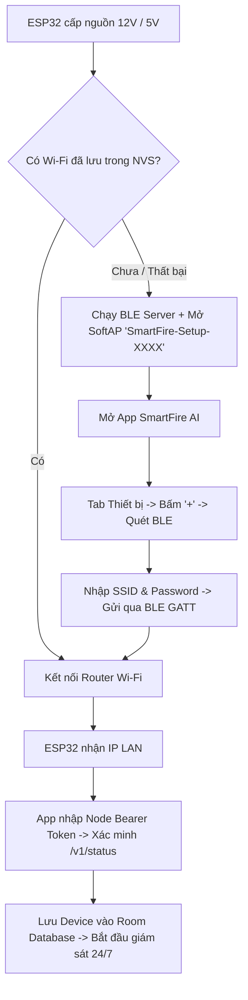

# SmartFire AI — Native Android IoT Control Center
### Sản phẩm STEM Nhóm 2 · Lớp 12D3
**Phiên bản:** `v1.0.1` (Cập nhật: 11/2026)  
**Nền tảng:** Android Native (Kotlin · Jetpack Compose · Material 3 · Room SQLite · BLE GATT · HTTP REST · Gemini AI · Local Analytics)  
**GitHub Releases:** [SmartFire AI v1.0.1](https://github.com/NirussVn0/Smartfire-AI/releases/tag/v1.0.1)

---

## 1. GIỚI THIỆU DỰ ÁN

**SmartFire AI** là ứng dụng Android Native hoàn chỉnh đóng vai trò trung tâm điều khiển và giám sát cho hệ sinh thái cảm biến cảnh báo cháy sớm ESP32. Ứng dụng tuân thủ nguyên lý thiết kế hệ thống phân tán:
> **"ESP32 owns the alarm state. The Android app owns the user configuration, indoor maps and persistent history."**

Hệ thống hoạt động theo triết lý **Local-First**: không phụ thuộc vào máy chủ đám mây bên thứ ba, toàn bộ dữ liệu cấu hình công trình, sơ đồ tầng/phòng, lịch sử sự kiện cảnh báo và chuỗi dữ liệu đo cảm biến được lưu trữ bền vững tại điện thoại thông qua **Room SQLite**.

---

## 2. TẢI BẢN DỰNG SẴN (PRE-BUILT APKS)

Các gói cài đặt APK cho phiên bản **v1.0.1** đã được tự động biên dịch và kiểm thử qua CI/CD GitHub Actions:

| Bản dựng | Kích thước | Keystore | Tải về trực tuyến (GitHub) | Đường dẫn cục bộ |
|---|---|---|---|---|
| **Release APK** | ~16.08 MB | `my-upload-key.jks` | [Tải SmartFire-AI-v1.0.1-release.apk](https://github.com/NirussVn0/Smartfire-AI/releases/download/v1.0.1/SmartFire-AI-v1.0.1-release.apk) | [SmartFire-AI-v1.0.1-release.apk](file:///d:/_PROJJECT/laptrinhnhung/Smartfire-AI/release/SmartFire-AI-v1.0.0-release.apk) |
| **Debug APK** | ~23.70 MB | `debug.keystore` | [Tải SmartFire-AI-v1.0.1-debug.apk](https://github.com/NirussVn0/Smartfire-AI/releases/download/v1.0.1/SmartFire-AI-v1.0.1-debug.apk) | [SmartFire-AI-v1.0.1-debug.apk](file:///d:/_PROJJECT/laptrinhnhung/Smartfire-AI/release/SmartFire-AI-v1.0.0-debug.apk) |

---

## 3. TÍNH NĂNG CHÍNH & ĐIỂM NÂNG CẤP (v1.0.1)

### 1. Giám sát thời gian thực & Bảo toàn tính toàn vẹn dữ liệu phần cứng (Hardware Invariant)
- Polling trạng thái định kỳ (~1.2s/node) qua endpoint HTTP `GET /v1/status` với xác thực `Authorization: Bearer <NODE_TOKEN>`.
- Phân định rõ trạng thái kết nối (`ONLINE_FRESH`, `STALE`, `OFFLINE`) và trạng thái phần cứng (`WARMING`, `UNCONFIGURED`, `NORMAL`, `SUSPECTED`, `ALARM`).
- **Cam kết dữ liệu thực (Real-Mode Invariant - v1.0.1):** Ở chế độ kết nối LAN thực tế, ứng dụng **hoàn toàn loại bỏ mọi dữ liệu cảm biến giả lập/jitter**. Khi node mất kết nối, cảnh báo `ALARM` được giữ nguyên với nhãn `OFFLINE`, tuyệt đối không tự bịa thành công cục bộ hay tắt còi phần cứng.

### 2. Cấu hình Wi-Fi qua Bluetooth Low Energy (BLE GATT Lifecycle v1.0.1)
- Tối ưu hóa chu trình kết nối BLE GATT: Thiết lập MTU 512 bytes, hàng đợi ghi descriptor (CCCD), tự động khám phá Service `4fafc201-1fb5-459e-8fcc-c5c9c331914b`.
- Ghi SSID & Password dạng JSON qua CONFIG characteristic `beb5483e-36e1-4688-b7f5-ea07361b26a8`.
- Lắng nghe STATUS notification từ `1c95d5e3-d8f7-413a-bf3d-7a2e5d7be87e` để nhận IP mới từ DHCP của router.
- Ngắt kết nối GATT sạch sẽ sau khi hoàn tất để tiết kiệm pin tối đa cho thiết bị di động.
- Hỗ trợ chuyển đổi tức thì sang chế độ **Nhập IP LAN thủ công** hoặc kết nối qua **SoftAP Recovery Portal** (`SmartFire-Setup-XXXX`) của ESP32.

### 3. Wizard thêm thiết bị thông minh (Onboarding Wizard v1.0.1)
- Giao diện trực quan 4 bước: Chọn vị trí phòng $\rightarrow$ Quét tìm BLE hoặc Nhập IP $\rightarrow$ Cung cấp Wi-Fi / Xác thực Token $\rightarrow$ Kiểm tra Ping trạng thái `/v1/status` trước khi lưu vào cơ sở dữ liệu.
- Phản hồi tiến trình kết nối theo thời gian thực: `SCANNING` $\rightarrow$ `CONNECTING_GATT` $\rightarrow$ `PROVISIONING_WIFI` $\rightarrow$ `OBTAINING_IP` $\rightarrow$ `VERIFIED`.

### 4. Bản đồ trong nhà 2D tương tác (Indoor Mapping)
- 3 chế độ: **Xem (View)**, **Chỉnh sửa (Edit)**, **Hiệu chuẩn tỷ lệ (Scan/Import)**.
- Thao tác thu phóng (Pinch to Zoom) và kéo bản đồ (Pan) mượt mà trên Canvas 60fps.
- Hiển thị vị trí trực quan của Cảm biến SmartFire, Bình chữa cháy, Cửa và Lối thoát hiểm (EXIT).
- Đánh dấu vị trí người dùng (chạm bản đồ hoặc quét mã QR định vị phòng).
- Thuật toán **Dijkstra Shortest Path** tìm đường ngắn nhất tới bình chữa cháy gần nhất và lối thoát hiểm, tự động gắn cờ cảnh báo đối với các lối đi xuyên qua phòng đang có báo động cháy.

### 5. Đồng bộ sự kiện & Chu trình lệnh bất đồng bộ HTTP 202 (Command Lifecycle)
- Đồng bộ `GET /v1/events?since=<seq>`, lưu trữ bền vững với khóa duy nhất `(deviceId, bootId, seq)`.
- Tự động phát hiện khi ESP32 khởi động lại (`boot_id` mới) và phát hiện mất sự kiện do đầy bộ đệm RAM 32 sự kiện (`historyGap=true`).
- Gửi lệnh `POST /v1/commands/ack`, `POST /v1/commands/silence` (tối đa 30s), `POST /v1/commands/test`.
- Quản lý trạng thái lệnh bất đồng bộ: `PENDING` $\rightarrow$ `APPLIED / REJECTED / EXPIRED`. Không tự bịa trạng thái thành công khi mất mạng.

### 6. Phân tích thống kê cục bộ & Tích hợp Gemini AI
- Tự động loại bỏ mẫu trong giai đoạn sấy nóng `WARMING` (`gas_ready=false`) khỏi đường cơ sở.
- Tính toán trung bình trượt hàm mũ (EWMA Baseline, $\alpha=0.25$), tốc độ biến thiên ($\Delta\text{ADC}/\text{s}$), và phát hiện dị biệt thống kê Z-Score $\ge 2.5\sigma$.
- Kết hợp mô hình Gemini AI (`gemini-3.8-flash`, `gemini-4-argon`, `gemini-3.5-flash-lite`) để phân tích ngữ cảnh, quét nhãn phòng sơ đồ và tra cứu cơ sở PCCC gần nhất qua Google Maps Grounding.

### 7. Chế độ trình diễn STEM (STEM Demo Mode)
- Chế độ mô phỏng trực quan độc lập hoàn toàn phục vụ thuyết trình lớp 12D3 khi không đốt lửa thật.
- Kích hoạt nhanh các kịch bản: Báo cháy Nhà Bếp, Mất Wi-Fi khi đang ALARM, Khởi động lại Node, Đang sấy nóng cảm biến.
- Hiển thị banner cảnh báo dữ liệu mô phỏng rõ ràng, tách biệt hoàn toàn với dữ liệu thực tế.

---

## 4. HƯỚNG DẪN KẾT NỐI VÀ VẬN HÀNH



1. **Nạp Firmware:** Nạp firmware `SmartFire_ESP32` phiên bản mới nhất (`v1.0.1`).
2. **Cấp Nguồn:** Cấp nguồn 12V qua module hạ áp LM2596 (ngõ ra 5V nuôi ESP32, 12V nuôi còi hú qua MOSFET D4184).
3. **Thêm Thiết Bị Trên App:**
   - Mở ứng dụng SmartFire AI $\rightarrow$ Chọn tab **Cảm biến** $\rightarrow$ Bấm nút **'+'**.
   - Chọn phòng lắp đặt (ví dụ: Phòng Khách hoặc Nhà Bếp).
   - Chọn **Quét BLE** để tìm thiết bị `SmartFire-Node-01` (hoặc nhập thủ công IP nếu đã biết).
   - Nhập thông tin Wi-Fi và **Node Bearer Token** (ít nhất 24 ký tự theo cấu hình firmware).
   - Ứng dụng gọi `GET /v1/status` để kiểm tra kết nối và xác minh `device_id`.
   - Đặt tên hiển thị cho cảm biến và kích hoạt giám sát thời gian thực!

---

## 5. GIỚI HẠN PHẦN CỨNG & AN TOÀN ĐÃ XÁC MINH

- **Nhiệt độ:** Firmware hiện tại trả về `"temperature_celsius": null` do chưa trang bị cảm biến nhiệt độ chuyên dụng được hiệu chuẩn. Ứng dụng hiển thị rõ trạng thái này, tuyệt đối không sinh nhiệt độ giả trong chế độ thực.
- **MQ-2:** Trả về giá trị ADC thô `[0..4095]`, không tự quy đổi sang ppm khi chưa có thiết bị hiệu chuẩn phòng thí nghiệm.
- **Bộ đệm sự kiện:** ESP32 lưu tối đa 32 sự kiện gần nhất trong RAM. Nếu điện thoại ngắt kết nối quá lâu, ứng dụng sẽ hiển thị cảnh báo `Missing Event Range`.
- **An toàn AI:** Tầng phân tích AI là lớp cố vấn bổ trợ, không bao giờ tự động gửi lệnh tắt còi hoặc hạ mức cảnh báo cháy của phần cứng.

---

## 6. QUY TRÌNH BIÊN DỊCH & CI/CD (BUILD & RELEASE)

Dự án tích hợp sẵn quy trình CI/CD hoàn chỉnh trên **GitHub Actions** (`.github/workflows/android-release.yml`):
- **Tự động kích hoạt:** Khi push code lên nhánh `main` hoặc tạo Git tag phiên bản (`v*`).
- **Môi trường:** Ubuntu Latest, JDK 21 (Eclipse Temurin), Android SDK Platform 36 & Build-Tools 36.0.0.
- **Tự động hóa:** Chạy Unit Test `testDebugUnitTest` $\rightarrow$ Tạo keystore upload $\rightarrow$ Biên dịch song song `assembleRelease` và `assembleDebug` $\rightarrow$ Tự động tạo GitHub Release đính kèm file APKs.

### Lệnh biên dịch cục bộ (Local Build):
```powershell
# Chạy unit tests
.\gradlew.bat testDebugUnitTest

# Biên dịch cả hai bản Release và Debug APK
.\gradlew.bat assembleRelease assembleDebug

# Vị trí file APK xuất xưởng:
# app/build/outputs/apk/release/app-release.apk
# app/build/outputs/apk/debug/app-debug.apk
```
