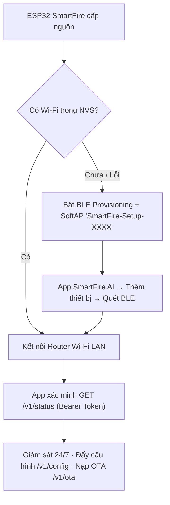

# SmartFire AI — Trung Tâm Điều Khiển & Cảnh Báo Cháy Thông Minh (Android)

> **Sản phẩm STEM Nhóm 2 · Lớp 12D3 · SOV Labs**  
> **Nền tảng:** Android Native (`minSdk 24`, `targetSdk 36`, Kotlin · Jetpack Compose · Material 3 · Room SQLite · BLE GATT · HTTP REST)  
> **Firmware tương thích:** [`SmartFire_ESP32`](https://github.com/NirussVn0/SmartFire_ESP32) (`v2.2.0-2level-sensors`)  
> **Tải APK mới nhất:** [GitHub Releases](https://github.com/NirussVn0/Smartfire-AI/releases/latest) · **Giấy phép:** [MIT License](LICENSE)

---

## 1. Giới Thiệu Dự Án

**SmartFire AI** là ứng dụng Android Native đóng vai trò trung tâm cấu hình, giám sát, định vị và dẫn đường thoát nạn cho hệ sinh thái cảm biến cảnh báo cháy **ESP32 SmartFire**.

Kiến trúc phân tán **Local-First**:
> **"ESP32 owns the alarm state. The Android app owns the user configuration, indoor maps and persistent history."**

- Không phụ thuộc server cloud bên ngoài: toàn bộ cấu hình nhà, sơ đồ 2D, nhật ký sự kiện và telemetry được lưu bền vững trên điện thoại qua **Room SQLite**.
- Khi mất mạng hoặc sập router, **ESP32 vẫn tự chủ kích hoạt còi 12V tại chỗ**; khi kết nối lại, điện thoại tự đồng bộ lịch sử sự kiện từ ESP32.

---

## 2. Tải APK Release Tự Động (CI/CD GitHub Releases)

Mỗi khi code được push lên nhánh `main` hoặc gắn tag `v*`, workflow [`.github/workflows/android-release.yml`](.github/workflows/android-release.yml) tự động chạy unit test (`testDebugUnitTest`), biên dịch **Release APK** & **Debug APK**, tạo `SHA256SUMS.txt` và phát hành trực tiếp lên mục **Releases**:

- **Trang tải bản mới nhất:** [https://github.com/NirussVn0/Smartfire-AI/releases/latest](https://github.com/NirussVn0/Smartfire-AI/releases/latest)
- **File chính:** `SmartFire-AI-release.apk` (Signed Release APK) + `SHA256SUMS.txt`.

> **Lưu ý cho chủ repo:** Để các bản Release tự động dùng chung một chữ ký ổn định (cài đè không cần gỡ app cũ), hãy cấu hình 3 GitHub Secrets trong `Settings → Secrets and variables → Actions`: `KEYSTORE_BASE64`, `STORE_PASSWORD`, `KEY_PASSWORD`.

---

## 3. Tính Năng Nổi Bật

### 1. Giám Sát Đa Node & Bảo Toàn Trạng Thái Phần Cứng
- Polling định kỳ qua Wi-Fi LAN (`GET /v1/status`, `GET /v1/events?since=<seq>`) với xác thực `Authorization: Bearer <TOKEN>`.
- Phân tách rõ trạng thái mạng (`ONLINE_FRESH`, `STALE`, `OFFLINE`) và trạng thái phần cứng (`WARMING`, `UNCONFIGURED`, `NORMAL`, `SUSPECTED`, `ALARM`, `FAULT`).
- Khi node mất kết nối lúc đang `ALARM`, app giữ nguyên cảnh báo kèm nhãn `OFFLINE`, không tự xóa hoặc giả mạo trạng thái an toàn.

### 2. Định Vị Trong Nhà / Ngoài Nhà Chính Xác & Lọc RSSI Kalman
- **Phát hiện Trong nhà / Ngoài nhà (`DeviceMovementTracker.evaluatePresenceZone`)**: Kết hợp 3 nguồn tín hiệu — đa giác ranh giới nhà (tọa độ không bị kẹp trong tường), GPS geo-fence thực tế (có bù sai số GPS) và suy hao tín hiệu Wi-Fi RSSI / trạng thái mất LAN.
- Khi người dùng bước ra khỏi nhà, icon người dùng tự thoát ra ngoài ranh giới bản đồ kèm nhãn **`NGOÀI NHÀ (~Xm)`** thay vì bị kẹt bên trong.
- **Lọc RSSI Kalman + Median 1D (`RssiKalmanFilter`)**: Khử nhiễu multipath Wi-Fi khi ước lượng khoảng cách theo mô hình Log-Distance (`tx_power_1m`, `path_loss_n` đồng bộ từ ESP32).

### 3. Biển Chỉ Dẫn Đường Kiểu Google Maps & Tạm Tắt Báo Động Máy Này
- Khi bấm dẫn đường tới **Cửa thoát hiểm**, **Bình chữa cháy**, **Điểm báo cháy** hoặc **Lộ trình 2 chặng (Bình CC ➔ Đám cháy)**:
  - **Tự động tạm tắt thông báo & còi trên chính điện thoại đang thao tác trước** (`muteLocalNotificationsTemporarily`) để người dùng tập trung sơ tán / xử lý sự cố.
  - Hiện **Biển chỉ dẫn nổi Turn-by-Turn** ngay trên màn hình hiện tại (ví dụ: *"Vị trí cửa thoát hiểm: 500m phía trước"*, *"50m phía trước rẽ trái"*, kèm thanh **"Lượt chờ: ..."**), sử dụng la bàn & GPS trực tiếp.
  - Người dùng chủ động chọn nút **"Xem Bản Đồ 2D"** hoặc **"Quay lại Tổng quan"** bất cứ lúc nào.

### 4. Cấu Hình Cảm Biến 2 Mức Độc Lập + Bật/Bỏ Qua Từng Cảm Biến + Wi-Fi OTA
Trong tab **Cài đặt** (hoặc chi tiết từng thiết bị) có thẻ **Cấu Hình & Cập Nhật ESP32 Qua Wi-Fi** (`EspWifiConfigAndOtaCard`):
- **Tách riêng 3 cảm biến với công tắc Bật / Bỏ qua độc lập** và **2 mức ngưỡng riêng biệt (Mức 1: Cảnh báo sớm vs Mức 2: Báo cháy khẩn cấp)**:
  1. **Khí / Khói MQ-2**: `mq2_enabled`, `gas_warn` (Mức 1), `gas_on` (Mức 2), `gas_off` (Hồi phục).
  2. **Nhiệt độ (°C)**: `temp_enabled`, `temp_warn_c` (Mức 1), `temp_alarm_c` (Mức 2).
  3. **Lửa / Cháy (Flame IR)**: `flame_enabled`, `flame_warn_ms` (Mức 1), `flame_alarm_ms` (Mức 2).
- **Hiệu chuẩn khoảng cách & phần cứng**: `tx_power_1m`, `path_loss_n`, `horn_enabled` (còi 12V), `gas_commissioned`.
- **Nút LƯU (SAVE)**: Lưu cấu hình cục bộ trên điện thoại (`SharedPreferences`).
- **Nút ĐẨY LÊN ESP (PUSH)**: Gửi cấu hình qua Wi-Fi (`POST /v1/config`) để ESP32 áp dụng ngay và lưu vào Flash NVS.
- **Nạp Code ESP32 Qua Wi-Fi (OTA `.bin`)**: Bấm **Chọn file `.bin`** → **PUSH OTA** để gửi firmware qua `POST /v1/ota` và tự reboot ESP32 mà không cần cắm cáp hay bấm nút `BOOT`.

### 5. Bản Đồ 2D Tương Tác, BLE Provisioning & Phân Tích Thống Kê
- Cấu hình Wi-Fi cho ESP32 qua **BLE GATT** (`4fafc201-1fb5-459e-8fcc-c5c9c331914b`) hoặc SoftAP Recovery Portal (`SmartFire-Setup-XXXX`).
- Bản đồ 2D hỗ trợ ghim cảm biến, cửa, bình chữa cháy, lối thoát hiểm, cầu thang; tìm đường ngắn nhất bằng **Dijkstra** (tránh phòng đang cháy).
- Phân tích EWMA / Z-Score cục bộ và hỗ trợ chế độ trình diễn **STEM Demo Mode**.

---

## 4. Kiến Trúc & Kết Nối Nhanh



---

## 5. Biên Dịch & Kiểm Thử Cục Bộ

```powershell
# Chạy toàn bộ Unit Test & Robolectric Test
.\gradlew.bat testDebugUnitTest

# Build bản Release & Debug APK
.\gradlew.bat assembleRelease assembleDebug

# APK xuất ra tại:
# app/build/outputs/apk/release/app-release.apk
# app/build/outputs/apk/debug/app-debug.apk
```

---

## 6. Giới Hạn An Toàn

- Đây là sản phẩm nghiên cứu STEM / KHKT THPT, chưa thay thế thiết bị PCCC đạt chuẩn kiểm định công nghiệp.
- Khi không gắn cảm biến nhiệt độ hiệu chuẩn, firmware trả về `temperature_celsius: null`; MQ-2 đọc theo đơn vị ADC 12-bit (`0..4095`).

---

## 7. Giấy Phép (License)

Dự án được phát hành theo giấy phép **MIT License** — xem chi tiết tại file [`LICENSE`](LICENSE).
